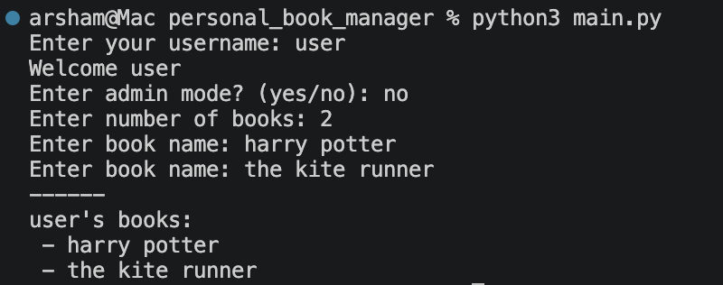
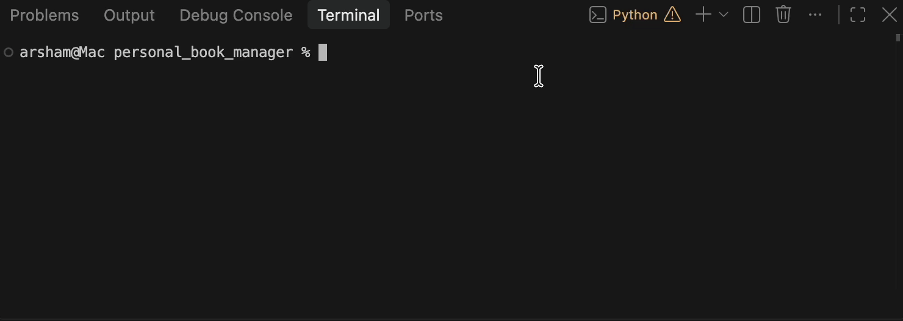

# Personal Book Manager


A simple personal book manager written in Python, with the option to categorize books by priority.

## Features
- Add multiple books
- Show books
- Save books
- Read saved books
- Admin Mode
- Set book priority level

## Book Priority
Every book can have one of the priority leves below set onto it:
- low
- medium
- high

## Requirements
Running the program requires the following:
- Python
- python-dotenv

## Installation
Install the required pacakges via the `requirements.txt` file:
```bash
python -m pip install -r requirements.txt
```

## Environment Setup
To run the program, you will have to first create a `.env` file in the project folder/directory.

Use the `.env.example` file as a template.

Add your admin password to the `.env` file as below:
```env
BOOK_MANAGER_ADMIN_PASSWORD=your_password_here
```

Replace `your_password_here` with your own admin password.

## Run the Program
Run the program using the main file:
```bash
python main.py
```

## Screenshot


## Demo


## Project Structure
```text
personal_book_manager/
├── README.md
├── books.py
├── .gitignore
├── .env.example
├── images/
│   ├── demo.gif
│   └── screenshot.png
├── main.py
└── requirements.txt
```

### File Description
| File | Description |
|----|----|
|`main.py`|Main file used to run the personal book manager|
|`books.py`|Code for book management functionality, including showing, saving and loading books|
|`.gitignore`|A list of files and folders to not be tracked by git|
|`.env.example`|An example for the necessary enviornment variables of the project|
|`requirements.txt`|lists necessary python packages for running the program|
|`images/`|folder iwth screenshots and demos of the project|
|`README.md`|project documentation|

## How It Works
1. The program recevies a username
2. Asks if user would like to enter admin mode, if yes, asks for admin password and checks it against the password written in `.env`
3. Recevies the number of books the user would like enter
4. Asks for the names of each book
5. Saves them into the `books.json` file
6. Loads previous books from the `books.json` file and shows them to the user alongside the new ones added

## Troubleshooting
If you hit any of the errors below while trying to run the Personal Book Manager, you may troubleshoot them via the following methods.

---
If you ever hit the error below:
```bash
FileNotFoundError
```

In the `books.py` file, make sure that the `load_books()` function is written as below:
```python
def load_books():
    try:
        with open("books.json", "r", encoding="utf-8") as file:
            return json.load(file)
    except FileNotFoundError:
        return []
```
---
If you ever hit the error below:
```bash
JSONDecodeError
```
There's a problem with your `books.json` file. It has probably not been created properly or is corrupted. 

Delete the `books.json` file and create a new one manually. If you don't have one, create it manually. 

---

If Python tells you it cannot find the `python-dotenv` package while trying to run the program, make sure the `python-dotenv` package is installed properly. If you are for example running Python 3.12, enter the following into terminal:

```bash
python3.12 -m pip install python-dotenv
```

Python has given this error to you because you most likely installed the packacged on another Python version installed on your computer.

---

If Python cannot find the admin password from the `.env` file, refer back to the [Environment Setup](#environment-setup) section to make sure you have properly created the `.env` file. You might've missed an important step in the process. 